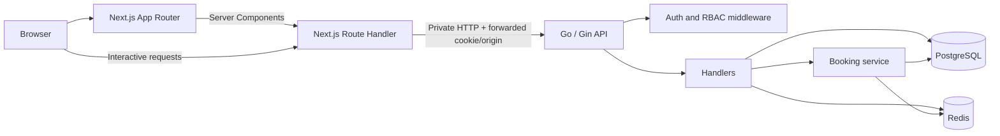

# ระบบจองตั๋วอีเวนต์ (Event Ticket Booking)

ระบบจองอีเวนต์แบบ Full-stack สำหรับดูและค้นหาอีเวนต์ จองสะสมได้ไม่เกิน 4 ที่ต่อผู้ใช้ต่ออีเวนต์ ดูและยกเลิกการจอง รวมถึงจัดการอีเวนต์สำหรับผู้ดูแลระบบ โดยออกแบบให้จำนวนที่นั่งถูกต้องเมื่อมีคำขอพร้อมกันจำนวนมาก

## Tech stack

- Frontend: Next.js App Router, React และ TypeScript แบบ strict
- Backend: Go, Gin และ GORM
- Database: PostgreSQL พร้อม versioned migrations ด้วย Goose
- Cache: Redis
- Authentication: JWT ใน `HttpOnly` cookie
- Runtime: Docker และ Docker Compose

## ฟีเจอร์หลัก

- สมัครสมาชิก เข้าสู่ระบบ และออกจากระบบ
- รายการอีเวนต์พร้อม prefix search และ pagination
- รายละเอียดอีเวนต์และจำนวนที่นั่งคงเหลือ
- จองเพิ่มอีเวนต์เดิมได้หลายครั้ง โดยยอดสถานะยืนยันรวมไม่เกิน 4 ที่
- ดูและยกเลิกการจองของตนเอง พร้อมคืนที่นั่งเพียงครั้งเดียว
- Admin สร้างและแก้ไขอีเวนต์ผ่าน modal และแสดงรายการหน้าละ 10 รายการ
- Redis cache สำหรับรายการอีเวนต์ พร้อม invalidation เมื่อข้อมูลเปลี่ยน
- Responsive UI, loading, error และ empty states

## วิธีติดตั้งและรันระบบ

### สิ่งที่ต้องมี

- Docker Desktop ที่รองรับ Docker Compose
- Git

### เริ่มระบบด้วย Docker

```powershell
git clone https://github.com/Terminal-cmd99/mid-fullstack-test.git
cd mid-fullstack-test
Copy-Item .env.example .env
docker compose up --build
```

สำหรับระบบที่เปิดสู่ภายนอก ต้องเปลี่ยน `POSTGRES_PASSWORD`, `JWT_SECRET` และรหัสผ่าน demo ใน `.env` ก่อนใช้งาน ห้ามนำ `.env` ขึ้น Git

เมื่อทุก service เป็น healthy ให้เปิด:

- Web application: <http://localhost:3000>
- Frontend healthcheck: <http://localhost:3000/health>
- API ผ่าน Next.js proxy: <http://localhost:3000/api/events>

หยุดระบบโดยเก็บข้อมูล PostgreSQL ไว้:

```powershell
docker compose down
```

PostgreSQL ใช้ named volume `pgdata` จึงยังเก็บข้อมูลหลัง `docker compose down` หากต้องการลบข้อมูล local ทั้งหมดจึงค่อยใช้ `docker compose down -v`

## Seed credentials

เมื่อ `SEED_DEMO=true` backend จะสร้างผู้ใช้ตัวอย่างและอีเวนต์ 20 รายการแบบ idempotent

| Role | Email | Password |
|---|---|---|
| Admin | `admin.demo@example.com` | `LocalAdmin123!` |
| User | `user.demo@example.com` | `LocalUser123!` |

ค่าดังกล่าวเป็น local demo values จาก `.env.example` เท่านั้น สำหรับ deployment ต้องกำหนดค่าใหม่ผ่าน environment variables ของ platform

## วิธีรัน Tests

### Unit tests ของ backend

```powershell
cd backend
go test ./...
```

### Integration และ concurrency tests ด้วย PostgreSQL/Redis จริง

รันจาก root ของ repository:

```powershell
docker compose -f docker-compose.test.yml up --build --abort-on-container-exit --exit-code-from backend-tests
docker compose -f docker-compose.test.yml down -v
```

Integration suite ครอบคลุม API flow หลัก, database constraints, cache invalidation, Redis fallback, ผู้ใช้ 100 คนแย่งจอง 10 ที่นั่ง, ผู้ใช้เดียวส่งคำขอพร้อมกันแต่ยอดไม่เกิน 4 และการยกเลิกพร้อมกันที่ต้องคืนที่นั่งเพียงครั้งเดียว

### Frontend quality checks

```powershell
cd frontend
npm ci
npm run lint
npm run typecheck
npm run build
```

## Architecture



- Next.js ใช้ Server Components สำหรับข้อมูลหลัก และใช้ Client Components เฉพาะฟอร์ม, modal และ interaction
- Route Handler `/api/[...path]` เป็น same-origin proxy และส่งต่อ cookie ไป backend จึงไม่เปิด JWT ให้ JavaScript อ่าน
- Backend แยก `middleware`, `handler`, `service`, `database`, `cache` และ `migrations`
- CRUD ที่ตรงไปตรงมาอยู่ใน handler ส่วนกฎที่มี transaction และ concurrency อยู่ใน booking service
- Backend รัน Goose migrations อัตโนมัติก่อน seed และเริ่ม HTTP server

## การป้องกันการจองเกิน

การสร้าง booking ทำภายใน PostgreSQL transaction เดียว โดยลดที่นั่งด้วย conditional atomic update:

```sql
UPDATE events
SET available_seats = available_seats - $quantity
WHERE id = $event_id
  AND available_seats >= $quantity
RETURNING available_seats;
```

PostgreSQL จะล็อก row ของอีเวนต์ระหว่างการ update ทำให้คำขอพร้อมกันถูก serialize ที่ฐานข้อมูล หากที่นั่งไม่พอ query จะไม่คืน row และ transaction ถูก rollback

จากนั้นระบบใช้ `INSERT ... ON CONFLICT (user_id, event_id) DO UPDATE` เพื่อบวกจำนวนลง booking เดิม โดยมีเงื่อนไขว่ายอดใหม่ต้องไม่เกิน 4 ที่ หากเงื่อนไขนี้ไม่ผ่าน transaction ทั้งก้อนจะ rollback รวมถึงการลดที่นั่งก่อนหน้า จึงรองรับการจองเพิ่มหลายครั้งโดยรักษายอดรวมต่อผู้ใช้ต่ออีเวนต์ไม่เกิน 4

การยกเลิกใช้ `SELECT ... FOR UPDATE` กับ event และ booking ตามด้วย conditional status update เฉพาะ booking ที่ยัง confirmed แล้วจึงคืนที่นั่ง วิธีนี้ป้องกันการกดยกเลิกพร้อมกันแล้วคืนที่นั่งซ้ำ

เลือกให้ PostgreSQL เป็นแหล่งความจริงแทน distributed lock เพราะ invariant ทั้ง booking และจำนวนที่นั่งอยู่ในฐานข้อมูลเดียวกัน Transaction จึง atomic, ตรวจสอบได้ และทำงานถูกต้องแม้ backend มีหลาย instance ส่วน Redis ใช้เฉพาะ cache และความผิดพลาดของ Redis ไม่กระทบความถูกต้องของการจอง

## Database constraints และ indexes

Constraints สำคัญประกอบด้วย foreign keys, unique email, `UNIQUE (user_id, event_id)`, quantity ระหว่าง 1–4, role/status ที่อนุญาต และเงื่อนไข `0 <= available_seats <= total_seats`

| Index | เหตุผล |
|---|---|
| `idx_events_start_id (starts_at, id)` | รองรับการกรองอีเวนต์อนาคตและเรียง `starts_at, id` สำหรับ pagination ที่ให้ผลลัพธ์คงที่ |
| `idx_events_title_prefix ((LOWER(title)) text_pattern_ops)` | รองรับ prefix search รูปแบบ `LOWER(title) LIKE 'keyword%'` โดยไม่ต้อง scan ทุก row |
| `idx_bookings_user_created (user_id, created_at DESC, id DESC)` | รองรับหน้าการจองของฉันที่กรองด้วย user และเรียงรายการล่าสุดก่อน |
| Unique indexes จาก `users.email` และ `(user_id, event_id)` | ป้องกันข้อมูลซ้ำที่ฐานข้อมูล และใช้เป็น conflict target สำหรับ booking upsert |

Connection pool กำหนดสูงสุด 25 open connections, 10 idle connections และอายุ connection 30 นาที เพื่อจำกัดการใช้ connection ของแต่ละ backend instance และนำ connection กลับมาใช้ซ้ำ

## Security

- Password hash ด้วย bcrypt และไม่ส่ง `password_hash` ใน JSON
- JWT อายุ 8 ชั่วโมง เก็บใน `HttpOnly`, `SameSite=Lax` cookie และใช้ `Secure` เมื่อ `APP_ENV=production`
- ตรวจ role admin ที่ middleware สำหรับ endpoint จัดการอีเวนต์
- ตรวจ Origin สำหรับ mutation endpoints เพื่อลดความเสี่ยง CSRF
- Validate และ normalize input ก่อนบันทึก พร้อม error response รูปแบบเดียวกัน
- Docker runtime ใช้ non-root user ทั้ง frontend และ backend
- Secrets รับจาก environment variables และ `.env` ถูก ignore จาก Git

## API documentation

OpenAPI 3.1 specification อยู่ที่ [`backend/openapi.yaml`](backend/openapi.yaml) สามารถเปิดด้วย Swagger Editor หรือ import เข้า Postman/Insomnia ได้

## Trade-offs และสิ่งที่จะปรับปรุง

- ใช้ offset pagination เพราะเข้าใจง่ายและเหมาะกับข้อมูล demo หากข้อมูลมีขนาดใหญ่จะเปลี่ยนเป็น cursor pagination
- Search เป็น case-insensitive prefix search เพื่อใช้ B-tree expression index ได้ หากต้องการค้นหาบางส่วนหรือรองรับ typo จะใช้ `pg_trgm` หรือ full-text search
- Redis cache ใช้ TTL 30 วินาทีและ versioned invalidation การเพิ่ม version หลีกเลี่ยง wildcard delete แต่ key รุ่นเก่าจะอยู่จนหมด TTL
- JWT เป็น stateless และ logout ทำโดยลบ cookie หากต้องการ revoke token ก่อนหมดอายุจะเพิ่ม token version หรือ denylist
- Seed ทำใน startup เพื่อให้ demo เปิดได้คำสั่งเดียว ระบบ production ขนาดใหญ่ควรแยก seed/migration เป็น release job
- แยก booking service เฉพาะ business logic ที่ซับซ้อน ส่วน CRUD ใช้ GORM ใน handler เพื่อลด boilerplate หากระบบโตขึ้นจะเพิ่ม repository interfaces และ service layer ให้ทุก domain
- ยังไม่มี CI, browser E2E, rate limiter, Nginx/load balancer และ production observability หากมีเวลาเพิ่มจะทำตามลำดับดังกล่าว

## คะแนนพิเศษที่ทำ

- Redis cache รายการอีเวนต์พร้อม versioned invalidation และ fallback ไป PostgreSQL เมื่อ Redis ใช้งานไม่ได้
- PostgreSQL connection pool configuration
- Concurrency integration test จำลอง 100 users พร้อมกันและ race cases ของ booking/cancellation
- Architecture diagram ใน README

Redis bonus ยังไม่ถือว่าครบทั้งข้อเพราะยังไม่มี rate limiting และ PostgreSQL advanced bonus ยังไม่ครบเพราะยังใช้ offset pagination และยังไม่มี `pg_trgm`/full-text search

## Deployment

- Production URL: https://frontend-production-df731db8.up.railway.app
- Deploy บน Railway โดยเปิด public domain เฉพาะ frontend ส่วน backend, PostgreSQL และ Redis ติดต่อกันผ่าน Railway private network
